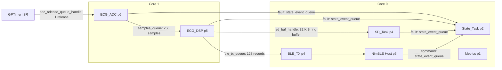

# ESP32 firmware workspace

Use an ESP-IDF 6.x terminal with the ESP32 toolchain installed:

```powershell
cd device_size/firmware_ws
idf.py set-target esp32
idf.py build
idf.py -p COM18 flash monitor
```

Replace `COM18` with the board's port. Configure the board and battery calibration
with `idf.py menuconfig`. Recording starts with GPIO0 or the BLE `start` command.

The application includes acquisition, SD recording, BLE and these runtimes:

- BPM/R peaks: the surveyed Fast-QRS 0.3.0 C port, fixed at 360 Hz, with a
  10-second context and a 5-second hop. The workspace uses 65,196 bytes,
  allocated once from internal RAM before BLE starts.
- SQI: Orphanidou rules and template matching, once per disjoint 10-second
  window. SQI is supplementary and does not gate AF detection.
- AF: Extra Trees RR INT8, 30 RR intervals, stride 15, confirmation 3/4.

Fast-QRS uses a zero-phase batch filter. R peaks arrive retrospectively and
carry their original timestamps in BLE events and `R_PEAK` SD journal rows.
Waveform rows keep their sample timestamps; their `is_r_peak` field stays zero.
The old MA/threshold CSV fields are reserved and stay zero.

Defaults select CPU 240 MHz and a 1 MHz timer. One-shot alarms use absolute
rational deadlines at 360 Hz (alternating 2,777/2,778 us intervals), rather
than accumulating a rounded period. Timer_Init registers Reading_ECG_Sensor
and enables GPTimer before recording can start. Each ISR copies its deadline,
ISR timestamp and sample index into a depth-one release queue.

On core 1, ECG_ADC (priority 6) reads the real ADC and copies samples into a
256-slot FIFO; ECG_DSP (priority 5) consumes it and runs Fast-QRS/SQI/AF.
Both queues count full-queue drops and never overwrite old samples.

## Deployment task communication



The processing graph is analog ADC -> notch 49-51 Hz -> Fast-QRS BPM/R peaks
-> RR features -> Extra Trees AF. SQI evaluates notch windows with their
Fast-QRS peaks and joins the result independently; it does not gate AF.
Callbacks execute in the calling task, without creating another task.

State_Task calls start/stop directly. acquisition_lock serializes those calls
with ADC acquisition; g_adcLock protects the shared ECG/battery ADC.
STOP halts the timer and ADC, sends a DSP FIFO sentinel and waits for drained,
then waits for sd_drained_semaphore before closing SD under sd_access_mutex.
BLE session/flush markers travel through ble_tx_queue and are acknowledged
with flushed. The NimBLE callback gives indication_done for confirmed sends.
GPIO card-detect ISR uses APP_NOTIFY_SD_DETECT task notification; state events
use a separate 16-slot state_event_queue. Statistics use short portMUX critical
sections. A failed BLE initialization leaves SD recording available.

The deployment has no replay hooks, sample-limit benchmark mode, separate
SD_Record writer, buffered BLE window mode or streaming SQI fallback.

ADC release-to-enqueue must finish within one sample period. DSP may finish
later; window completion must occur within the 1,800-sample hop period.
Metrics report these two deadlines separately, plus sample age, FIFO peak,
drops and input/output hashes. STOP first halts acquisition, then drains the
DSP FIFO before the SD writer is drained and files are closed. Sampling
timestamps come from acquisition rather than delayed DSP execution.

Host timer and battery verification, from repository root:

```powershell
python -m pip install -r device_size/requirements-dev.txt
python -m pytest device_size/tests -q
```

Build products and locally generated sdkconfig files are ignored by Git.

## BLE waveform transport

The current waveform packet is v4/type 1: a 16-byte little-endian `<BBBBIQ>`
header (version, type, count, reserved=1, first acquisition index, first
scheduled timestamp in microseconds), followed by signed int16 notch samples.
Notification batches contain up to 32 samples; indication batches up to 96,
limited by the negotiated ATT MTU. At MTU23, two samples fit. The absolute
sample index and 360 Hz rational clock define subsequent scheduled timestamps.
Indices restart at zero per recording. A gap flushes the previous batch.

Analysis events use v5/type 2, 24 bytes, with a uint64 microsecond timestamp;
at MTU below 27 they use the legacy 20-byte v1 event encoding with milliseconds.
Battery remains v1/type 3. Retrospective R-peak events retain their original
sample timestamps. Receivers must support these packet versions.

Acquisition and DSP enqueue without waiting for BLE. A stalled/disconnected
receiver can exhaust the finite queue; STOP logs queue drops and transport
failures. Accepted notifications are not an end-to-end acknowledgement.
STOP drains queued records and flushes partial packets; indication sends wait
for confirmation through indication_done. Full-board sustained timing, BLE
reception and SD persistence still require validation on hardware.
