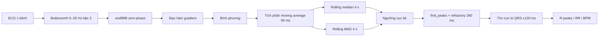

# Adaptive Pan–Tompkins v2: kiến trúc, khả năng port và hướng cải thiện

Ngày chạy: 07/10/2026

## Kết luận ngắn

Adaptive PT v2 hiện tại là detector Python theo block, phù hợp làm baseline nghiên cứu nhưng **không thể dịch nguyên xi xuống firmware**. Ba nguyên nhân chính là lọc zero-phase nhìn tương lai, median/MAD đối xứng 4 giây và peak finder xử lý cả mảng.

Một bản Python streaming có state hữu hạn đã được viết để kiểm tra đường port. Bản này chạy sample-by-sample, không phụ thuộc kích thước chunk và mọi khối đều có ánh xạ trực tiếp sang C. Tuy nhiên kết quả external chưa đủ để thay firmware hiện tại: nó tốt hơn firmware trong nhiễu rất nặng nhưng kém hơn trên QTDB và vẫn kém v2 offline.

## Pipeline Adaptive PT v2 hiện tại



Ngưỡng hiện tại:

```text
threshold = rolling_median
          + 0.38 × max(6 × rolling_MAD, global_95th_span)
```

Đây là cấu hình frozen, được chọn trên 12 record QTDB development và không chỉnh lại bằng MITDB external test.

## Vì sao chưa portable

| Khối Python v2 | Vấn đề trên ESP32 | Thay thế portable |
|---|---|---|
| `sosfiltfilt` | Cần toàn block và nhìn tương lai | SOS IIR causal, giữ 2 state/section |
| Median/MAD đối xứng 4 s | Khoảng 1.440 mẫu ở 360 Hz và chi phí sắp xếp | SPKI/NPKI EWMA hoặc quantile estimator streaming |
| `global percentile` | Cần giữ/phân tích block | Noise floor EWMA có giới hạn tốc độ thay đổi |
| `find_peaks` | API theo mảng | So sánh ba mẫu liên tiếp |
| Relocation ±120 ms | Dùng 120 ms tương lai | History phía quá khứ và decision delay hữu hạn |
| NumPy float64 | RAM/CPU không đại diện MCU | `float32`, Q15/Q31 hoặc `int16_t` cho raw ring |

## Bản Python streaming đã triển khai

Code nằm trong `src/ecg_benchmark/rpeaks.py`:

- `AdaptivePTPortable`: API `push(sample)` sample-by-sample.
- `detect_r_peaks_adaptive_portable`: wrapper batch dùng đúng state machine trên.

```mermaid
flowchart LR
    A[Sample ECG] --> B[2 SOS bandpass causal 5–25 Hz]
    B --> C[x[n] - x[n-1]]
    C --> D[Bình phương]
    D --> E[Ring moving average 110 ms]
    E --> F[Local maximum 3 mẫu]
    F --> G[SPKI / NPKI EWMA]
    G --> H{Qua threshold và refractory 260 ms?}
    H -- Không --> I[Cập nhật noise level]
    H -- Có --> J[Raw-history relocation 100 ms]
    J --> K[Timestamp R đã hiệu chỉnh]
```

Cấu hình được chọn **chỉ trên 12 QTDB development records**:

- integration: 110 ms;
- raw relocation: 100 ms;
- threshold fraction: 0,35;
- settle: 250 ms;
- warm-up: 1 giây;
- refractory: 260 ms.

Raw relocation thay cho bandpass-extremum đã tăng development `F1@50 ms` từ 0,7872 lên 0,9058.

## Kết quả external

### QTDB locked test

70 record ngoài development, hai cửa sổ 60 giây/record, không delay correction:

| Detector | Precision | Recall | F1 @50 ms | F1 @100 ms | BPM MAE | Host latency/60 s |
|---|---:|---:|---:|---:|---:|---:|
| Adaptive PT v1 offline | 0,8940 | 0,8898 | **0,8919** | **0,9969** | 0,178 | 3,69 ms |
| Adaptive PT v2 offline | 0,8939 | 0,8853 | 0,8896 | 0,9944 | 0,208 | 3,68 ms |
| Firmware hiện tại | 0,8401 | 0,8492 | **0,8446** | **0,9801** | 0,953 | **2,04 ms** |
| Adaptive PT portable Python | 0,8036 | 0,8245 | **0,8139** | 0,9375 | 4,970 | 89,46 ms |

Latency Python streaming cao vì vòng lặp được thực hiện ở interpreter. Nó không dự báo latency C; số phép toán và RAM mới là tiêu chí port. Tuy nhiên F1/BPM phản ánh đúng logic và cho thấy state machine hiện tại chưa nên thay firmware.

### NSTDB, chỉ cửa sổ có nhiễu

F1 tại ±50 ms:

| Detector | −6 dB | 0 dB | 6 dB | 12 dB | 18 dB | 24 dB |
|---|---:|---:|---:|---:|---:|---:|
| Adaptive PT v2 offline | **0,5215** | **0,8961** | 0,9797 | 0,9730 | 0,9730 | 0,9730 |
| Adaptive PT portable | 0,4649 | 0,7295 | **0,9864** | **0,9864** | 0,9864 | 0,9864 |
| Firmware hiện tại | 0,3253 | 0,6892 | 0,9216 | 0,9797 | **1,0000** | **1,0000** |

Bản portable cải thiện so với firmware ở −6, 0 và 6 dB, nhưng v2 offline vẫn mạnh hơn tại vùng khó 0 dB và −6 dB.

## Ước lượng tài nguyên khi port C ở 360 Hz

Với `float32` và raw history `int16_t`:

| State | Kích thước gần đúng |
|---|---:|
| 2 SOS × 2 state | 16 byte |
| Energy ring 110 ms, 40 float | 160 byte |
| Raw ring khoảng 100 ms, 40 int16 | 80 byte |
| Levels, counters, timestamps | dưới 100 byte |
| Tổng state detector | khoảng **0,35–0,5 KB** |

Mỗi sample cần hai biquad, một phép đạo hàm, bình phương, cập nhật moving sum và vài phép so sánh. Ở 360 sample/s, tải CPU phù hợp ESP32. Khi có candidate, relocation quét khoảng 36–40 mẫu; thao tác này chỉ xảy ra vài lần mỗi giây.

Đánh giá: **khả thi cao về RAM và CPU**, nhưng **chưa đạt cổng chất lượng**.

## Cách cải thiện tiếp theo

### 1. Search-back theo RR

Giữ candidate dưới threshold mạnh nhất. Nếu không có beat sau khoảng `1,5–1,66 × RR trung bình`, xét lại candidate bằng threshold thấp hơn. Đây là phần Pan–Tompkins kinh điển còn thiếu và có khả năng giảm FN/BPM error mà chỉ cần vài scalar state.

### 2. Tách decision threshold và localization confidence

Energy envelope quyết định “có QRS”, còn raw relocation chỉ quyết định timestamp. Nếu raw window không có extremum nổi bật so với MAD/biên độ nền, giữ timestamp bandpass hoặc hạ confidence thay vì luôn chọn cực trị lớn nhất.

### 3. SQI/noise gate

Không dùng entropy một mình. Gate nên kết hợp:

- năng lượng ngoài dải QRS sau bandpass;
- spectral entropy hoặc sample entropy trên cửa sổ ngắn;
- candidate rate bất thường;
- saturation/flatline;
- độ tương phản `SPKI/NPKI`.

Ở SQI tốt, giữ firmware hiện tại. Khi SQI giảm gần vùng 0–6 dB, bật threshold/search-back mạnh hơn hoặc detector fallback. Ở SQI rất xấu, đánh dấu RR không tin cậy thay vì phát nhiều beat giả vào AF.

### 4. Cổng nghiệm thu trước khi sửa firmware

Chỉ port C sau khi bản Python causal đạt đồng thời:

- QTDB locked `F1@50 ms` ít nhất bằng firmware 0,8446;
- NSTDB 0 dB cao hơn firmware 0,6892 và không giảm đáng kể ở ≥6 dB;
- BPM MAE dưới 1 BPM;
- stream output độc lập chunk size;
- sau port, C/Python lệch không quá 1 sample trên golden vectors.

## Quyết định hiện tại

Không port Adaptive PT v2 offline nguyên trạng. Không thay firmware bằng prototype portable hiện tại. Giữ code streaming làm nền cho vòng cải thiện tiếp theo, ưu tiên **RR search-back + confidence-aware relocation + SQI gate**, sau đó khóa trên development và chỉ chạy external test một lần.
