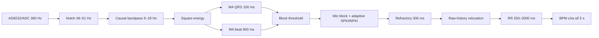
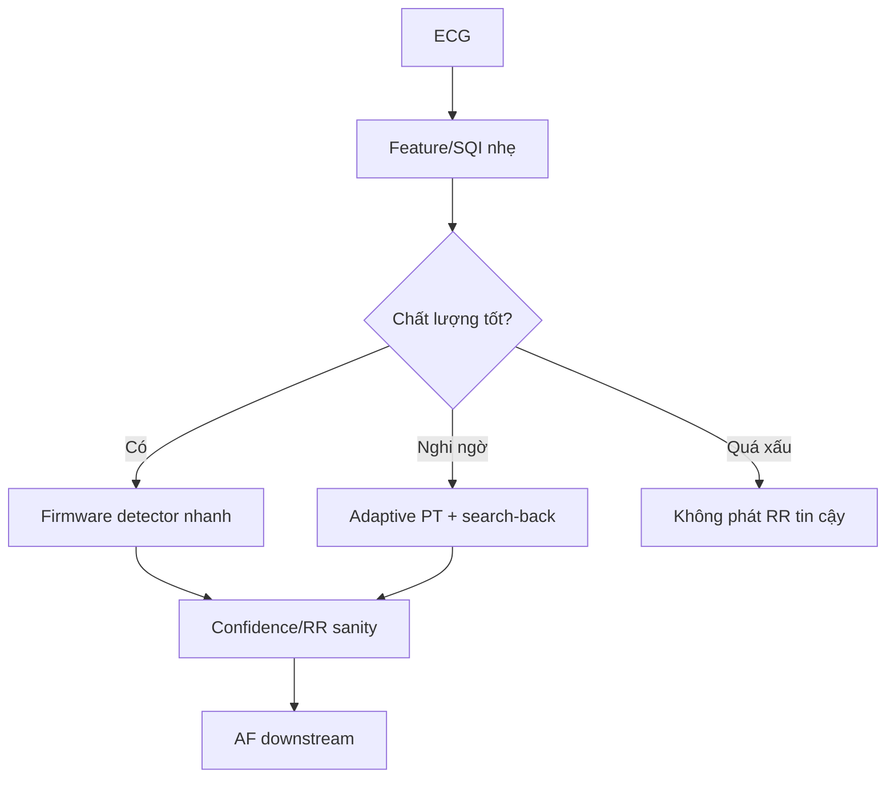

# Cẩm nang QRS, BPM, SQI và AF cho luận án ECG nhúng

Tài liệu này gom các kiến thức cần thiết để hiểu, thiết kế, đánh giá và bảo vệ pipeline:

```text
ECG thô → lọc/SQI → phát hiện QRS/R-peak → RR/BPM → đặc trưng nhịp → phát hiện AF
```

Mục tiêu không phải ghi nhớ mọi công thức. Mục tiêu là trả lời được bốn câu hỏi:

1. Detector đang phát hiện đại lượng gì và vì sao nó hoạt động?
2. Nó thất bại trong loại nhiễu hoặc morphology nào?
3. Đổi accuracy lấy RAM/latency như thế nào?
4. Sai số R-peak ảnh hưởng thực sự tới BPM và AF downstream ra sao?

---

## 1. Kiến thức ECG bắt buộc

### 1.1 Các thành phần chính

- **P wave**: khử cực nhĩ.
- **QRS complex**: khử cực thất; thường có độ dốc và năng lượng cao nhất.
- **R-peak**: cực trị đại diện của QRS, dùng làm mốc thời gian beat.
- **T wave**: tái cực thất; có thể bị nhận nhầm thành QRS nếu biên độ lớn.
- **RR interval**: khoảng thời gian giữa hai R-peak liên tiếp.

QRS detection và R-peak localization không hoàn toàn giống nhau:

- QRS detection hỏi: “Có một nhịp ở vùng này không?”
- R-peak localization hỏi: “Timestamp đại diện chính xác nằm ở mẫu nào?”

Detector có thể tìm đúng mọi QRS nhưng vẫn có F1 thấp ở tolerance ±25/50 ms nếu timestamp bị lệch cố định.

### 1.2 BPM và RR

Với một RR interval tính bằng giây:

```text
BPM = 60 / RR
```

Với RR tính bằng mili giây:

```text
BPM = 60000 / RR_ms
```

Trong thực tế không nên lấy một RR duy nhất. Có thể dùng:

- median của các RR hợp lệ;
- trung bình trong cửa sổ 5–10 giây;
- trimmed mean để bỏ outlier;
- giới hạn sinh lý, ví dụ RR 250–2000 ms.

**Điểm phải nắm:** BPM có thể vẫn đúng khi vị trí R-peak kém. Hai peak cùng lệch một lượng gần bằng nhau sẽ tạo RR gần đúng. Vì thế BPM MAE thấp không chứng minh RR đủ sạch cho AF.

### 1.3 Các nguồn biến thiên

- QRS dương, âm hoặc hai pha tùy lead.
- QRS rộng ở PVC, bundle branch block hoặc pacing.
- Biên độ thay đổi theo điện cực, tư thế và chuyển động.
- Nhịp nhanh làm T wave gần QRS kế tiếp.
- AF tạo RR không đều, khiến luật search-back dựa trên RR trung bình khó hơn.

---

## 2. Nhiễu ECG cần nhận biết

### 2.1 Baseline wander

Nguồn: hô hấp, thay đổi tiếp xúc điện cực, chuyển động chậm. Năng lượng chủ yếu ở tần số thấp.

Biện pháp:

- high-pass khoảng 0,5–5 Hz tùy mục tiêu;
- detrending;
- DWT/baseline estimation;
- tránh cutoff quá cao làm biến dạng ST/P/T.

### 2.2 Power-line interference

Nhiễu 50 Hz tại Việt Nam, đôi khi 60 Hz tùy môi trường.

Biện pháp:

- notch filter;
- low-pass dưới 40 Hz nếu chỉ cần QRS/BPM;
- thiết kế analog tốt, common-mode rejection và tiếp xúc điện cực tốt.

### 2.3 Muscle artifact

EMG có phổ rộng, dễ tạo nhiều local maxima và candidate giả.

### 2.4 Electrode motion

Thường tạo spike hoặc dịch baseline lớn. Đây là loại nhiễu nguy hiểm vì có thể giống QRS thật.

### 2.5 Saturation, clipping và flatline

- Clipping tạo cạnh dốc lớn, dễ bị detector coi là QRS.
- Flatline khiến detector không còn thông tin nhưng đôi khi vẫn tạo event ở biên chuyển trạng thái.

### 2.6 NSTDB

MIT-BIH Noise Stress Test Database có ba nguồn noise:

- `bw`: baseline wander;
- `ma`: muscle artifact;
- `em`: electrode motion.

Các record `118eXX` và `119eXX` là ECG đã trộn noise theo SNR; `bw`, `ma`, `em` riêng lẻ chỉ là noise source, không được chấm như ECG có beat.

---

## 3. Pipeline QRS cổ điển

Kiến trúc chung:


### 3.1 Pan–Tompkins, 1985

Pipeline kinh điển:

```text
bandpass → derivative → square → moving-window integration
→ adaptive signal/noise thresholds → refractory → search-back
```

Ý nghĩa từng khối:

- Bandpass giữ vùng năng lượng QRS và giảm baseline/high-frequency noise.
- Derivative nhấn mạnh độ dốc.
- Square đổi mọi độ dốc thành dương và khuếch đại độ dốc lớn.
- Moving integration tạo envelope phản ánh cả độ rộng và năng lượng QRS.
- SPKI/NPKI theo dõi mức peak tín hiệu và peak nhiễu.
- Refractory ngăn phát hiện trùng QRS/T wave.
- Search-back phục hồi beat có biên độ thấp khi khoảng RR quá dài.

Ngưỡng Pan–Tompkins thường có dạng:

```text
threshold = NPKI + α × (SPKI − NPKI)
```

`α` thường khoảng 0,25 nhưng không phải hằng số tối ưu cho mọi domain.

**Phải nắm:** Pan–Tompkins không chỉ là bộ lọc + threshold. Search-back, cập nhật signal/noise level và refractory là phần quyết định tính adaptive.

Nguồn gốc: [Pan và Tompkins, 1985](https://pubmed.ncbi.nlm.nih.gov/3997178/).

### 3.2 Hamilton–Tompkins

Hamilton tiếp tục hướng threshold thích nghi và luật quyết định thời gian thực. Khi so sánh implementation cần kiểm tra:

- bandpass cụ thể;
- cách lấy candidate;
- cách cập nhật threshold;
- cách xử lý T wave và missed beat.

Không nên coi mọi thư viện ghi “Hamilton” là cùng một implementation.

Nguồn: [Hamilton và Tompkins](https://pubmed.ncbi.nlm.nih.gov/3817849/).

### 3.3 Christov

Dùng các thành phần threshold thích nghi theo:

- biên độ;
- tốc độ thay đổi;
- khoảng thời gian từ beat trước.

Ưu điểm: thích nghi nhiều cơ chế. Nhược điểm: nhiều state và chi tiết implementation ảnh hưởng lớn.

Nguồn: [Christov, 2004](https://pmc.ncbi.nlm.nih.gov/articles/PMC516783/).

### 3.4 Elgendi / Two Moving Average

Ý tưởng:

- một moving average ngắn phản ánh vùng QRS;
- một moving average dài phản ánh beat/background;
- so sánh hai đường để tạo block QRS;
- dùng độ dài block và cực trị để xác nhận beat.

Đây là họ thuật toán gần nhất với front-end firmware hiện tại.

Nguồn: [Elgendi, 2013](https://pmc.ncbi.nlm.nih.gov/articles/PMC3774726/).

### 3.5 GQRS và XQRS

- **GQRS**: detector chuẩn trong WFDB, mạnh ở evaluation offline nhưng có thể có delay đặc trưng.
- **XQRS**: detector WFDB mới hơn, kết hợp envelope và threshold thích nghi.

Đây là baseline thư viện tốt vì implementation phổ biến và tái lập được, nhưng không mặc định là phù hợp ESP32.

### 3.6 Wavelet/SWT

Wavelet phân tích tín hiệu theo thang thời gian–tần số. QRS được làm nổi ở một số scale.

- DWT giảm chiều dài theo level.
- SWT giữ nguyên chiều dài và gần shift-invariant, phù hợp localization.

Đổi lại, SWT cần nhiều convolution/buffer hơn bandpass IIR.

---

## 4. Deep-learning detector và accuracy ceiling

### 4.1 CNN 1D

CNN học kernel phát hiện morphology trực tiếp từ tín hiệu hoặc feature.

Ưu điểm:

- học được waveform phức tạp;
- inference song song;
- có thể lượng tử hóa INT8.

Nhược điểm:

- dễ leakage nếu chia beat/window thay vì chia subject/record;
- cần dataset đa dạng;
- latency/RAM phụ thuộc receptive field và feature map, không chỉ số parameter.

### 4.2 LSTM/BiLSTM

LSTM học phụ thuộc theo thời gian. BiLSTM dùng cả quá khứ và tương lai nên:

- tốt cho offline;
- không causal;
- cần buffer/latency;
- khó làm detector liên tục trên MCU nhỏ.

ecg2rr BiLSTM không nên dùng làm ceiling unbiased trong protocol MITDB/NSTDB hiện tại vì training có sử dụng MIT-BIH và NSTDB. Model cũng được huấn luyện chủ yếu trên cửa sổ normal-beat, nên có domain mismatch với morphology bệnh lý.

### 4.3 SWT + separable CNN + ASPP

Đây là accuracy ceiling đang dùng:

```text
DWT baseline removal + low-pass
→ SWT level 4 + derivative, hai channel
→ residual separable-convolution encoder
→ ASPP multiscale
→ decoder segmentation
→ probability smoothing/localization
```

Checkpoint chính chủ:

- 693.016 trainable parameters;
- khoảng 2,9 MB;
- QTDB benchmark nội bộ hiện tại: F1 0,9984 tại ±50 ms;
- NSTDB aggregate: F1 0,9683 tại ±50 ms.

Model là ceiling chất lượng, không phải ứng viên chạy thường trực trên ESP32.

Nguồn: [paper Scientific Reports](https://pmc.ncbi.nlm.nih.gov/articles/PMC9669048/) và [code chính chủ](https://github.com/dactylogram/ECG_peak_detection).

### 4.4 Depthwise separable convolution

Convolution thường trộn cả không gian và channel trong một phép tính. Separable convolution tách:

1. depthwise convolution trên từng channel;
2. pointwise 1×1 để trộn channel.

Nó giảm parameter/MAC so với convolution thường, nhưng feature maps trung gian vẫn có thể tốn RAM.

### 4.5 ASPP

Atrous Spatial Pyramid Pooling dùng nhiều dilation rate để nhìn QRS ở nhiều scale. Nó tăng receptive field mà không cần kernel rất lớn. Phù hợp ceiling, nhưng tăng số branch và buffer.

---

## 5. Kiến trúc pipeline hiện tại

Firmware hiện tại là hybrid:

- front-end gần Elgendi/Two Moving Average;
- decision threshold có nguồn gốc Pan–Tompkins/Hamilton;
- raw-history relocation là phần tùy biến.



Điểm mạnh:

- causal;
- sample-by-sample;
- RAM rất nhỏ;
- latency host thấp;
- chạy được cả QRS dương và âm nhờ energy/absolute magnitude.

Điểm yếu:

- localization chưa ổn ở nhiều morphology QTDB;
- threshold/block dễ gãy ở 0 dB và −6 dB;
- chưa có confidence/SQI chính thức;
- RR lỗi vẫn được chuyển thẳng xuống AF.

---

## 6. Adaptive PT v1, v2 và bản portable

### 6.1 Adaptive PT v1

```text
zero-phase bandpass 5–25 Hz
→ derivative²
→ integration 120 ms
→ rolling median/MAD 4 s
→ threshold scale 0,28
→ refractory 240 ms
→ relocation ±120 ms
```

Đây là baseline Python mạnh nhưng offline/non-causal.

### 6.2 Adaptive PT v2 frozen

Khác v1 ở ba tham số:

- refractory 260 ms;
- integration 90 ms;
- threshold scale 0,38.

V2 được chọn trên 12 QTDB development records nhưng không vượt v1 trên MITDB external. Bài học: phiên bản “mới hơn” không tự động tốt hơn và tuning theo một noise protocol có thể đổi recall lấy precision.

### 6.3 AdaptivePTPortable

Bản streaming mới:

```text
SOS causal 5–25 Hz
→ derivative
→ square
→ ring integration 110 ms
→ local maximum ba mẫu
→ SPKI/NPKI EWMA
→ refractory 260 ms
→ raw-history relocation 100 ms
```

State ước lượng khi port C ở 360 Hz: khoảng 0,35–0,5 KB.

Kết quả external QTDB locked:

| Detector | F1 @50 ms | F1 @100 ms | BPM MAE |
|---|---:|---:|---:|
| Adaptive PT v1 offline | 0,8919 | 0,9969 | 0,178 |
| Adaptive PT v2 offline | 0,8896 | 0,9944 | 0,208 |
| Firmware hiện tại | 0,8446 | 0,9801 | 0,953 |
| Adaptive portable | 0,8139 | 0,9375 | 4,970 |

**Kết luận:** portable về kỹ thuật, chưa đạt chất lượng để thay firmware.

Chi tiết: `docs/ADAPTIVE_PT_V2_PIPELINE_VA_KHA_NANG_PORT_FIRMWARE.md`.

---

## 7. SQI và noise gate

### 7.1 SQI là gì?

Signal Quality Index là đại lượng mô tả mức tin cậy của tín hiệu hoặc của detection. SQI không nhất thiết phải dự đoán chính xác SNR; nó chỉ cần tách được:

- tín hiệu đủ tốt để dùng detector nhẹ;
- tín hiệu nghi ngờ cần detector mạnh/fallback;
- tín hiệu quá xấu phải suppress RR/AF.

### 7.2 Entropy

Entropy đo mức độ phân tán/khó dự đoán của tín hiệu.

- Spectral entropy tăng khi phổ trở nên phẳng/rộng.
- Sample entropy đo độ bất quy tắc theo thời gian.
- Shannon entropy trên amplitude histogram đo độ phân tán biên độ.

Entropy sau bandpass cao bất thường có thể chỉ ra EMG/electrode noise. Nhưng AF thật cũng tạo RR irregularity, nên không được lấy entropy RR làm noise gate duy nhất.

### 7.3 Feature gate nên dùng

Một gate nhẹ nên kết hợp:

- bandpower trong và ngoài dải QRS;
- spectral entropy sau bandpass;
- saturation/clipping ratio;
- flatline ratio;
- derivative/energy outlier rate;
- số candidate mỗi giây;
- tỷ lệ SPKI/NPKI;
- agreement giữa hai detector nhẹ nếu đủ tài nguyên.

### 7.4 Kiến trúc gate đề xuất



Gate phải có hysteresis để tránh đổi mode liên tục.

---

## 8. Metric phải hiểu

### 8.1 TP, FP, FN

- TP: peak ước lượng khớp một annotation trong tolerance.
- FP: peak dư.
- FN: peak bị bỏ sót.

Matching phải one-to-one. Một peak không được khớp nhiều annotation.

### 8.2 Precision, Recall, F1

```text
Precision = TP / (TP + FP)
Recall    = TP / (TP + FN)
F1        = 2PR / (P + R)
```

Trong pipeline RR/AF:

- FN thường tạo RR gần gấp đôi;
- FP thường chia một RR thành hai khoảng ngắn;
- cả hai đều nguy hiểm hơn một localization jitter nhỏ.

### 8.3 Tolerance

Phải báo ít nhất:

- ±25 ms: localization rất nghiêm;
- ±50 ms: localization nghiêm;
- ±100 ms: QRS detection thực dụng;
- ±150 ms: protocol phổ biến nhưng có thể che delay.

Không được so F1 của paper ở ±150 ms với F1 của pipeline ở ±50 ms mà không ghi rõ.

### 8.4 Timing MAE và RR MAE

- Timing MAE: sai số vị trí giữa peak matched và annotation.
- RR MAE: sai số của khoảng RR giữa các peak matched.

RR MAE thường liên quan trực tiếp tới downstream hơn timing MAE tuyệt đối.

### 8.5 BPM MAE

```text
BPM MAE = mean(|BPM_est − BPM_ref|)
```

Cần báo song song QRS F1 vì BPM robust median có thể che FP/FN cục bộ.

### 8.6 Latency

Cần phân biệt:

- compute latency: thời gian CPU chạy thuật toán;
- algorithmic delay: cần chờ bao nhiêu mẫu tương lai;
- event latency: thời điểm firmware phát event;
- corrected R timestamp: timestamp ước lượng sau relocation.

Detector có thể compute nhanh nhưng phải chờ 100 ms tương lai, nên vẫn có decision latency 100 ms.

### 8.7 RAM

Python `tracemalloc` không đo đúng RAM native/TensorFlow/PyTorch và không đại diện ESP32.

Trên firmware cần đo:

- static/BSS;
- stack high-water mark;
- heap trước/sau init;
- minimum free heap;
- PSRAM nếu có;
- flash/model size.

---

## 9. Protocol benchmark đúng

### 9.1 Nguyên tắc công bằng

Mọi detector phải dùng:

- cùng ECG segment;
- cùng channel;
- cùng annotation;
- cùng matcher/tolerance;
- cùng cách warm-up timing;
- cùng số lần lặp;
- không detector-specific delay correction nếu không khai báo.

### 9.2 Không tune trên test

Chia rõ:

- development: chọn tham số;
- validation: chọn architecture/early stopping;
- external locked test: chỉ chạy sau khi frozen.

Với DL phải chia theo subject/record, không chia ngẫu nhiên các beat của cùng bệnh nhân sang train và test.

### 9.3 Cross-database

Một con số MITDB cao chưa chứng minh generalization. Nên có:

- MITDB: arrhythmia/morphology;
- QTDB: đa morphology và annotation;
- NSTDB: robustness theo noise/SNR;
- nếu có thể, INCART/European ST-T hoặc ECG AD8232 thật.

### 9.4 Delay correction

Nếu đo delay trung vị trên test rồi dịch peak để tăng F1, đó là leakage. Delay correction phải:

- suy ra từ lý thuyết filter; hoặc
- ước lượng trên development rồi frozen.

### 9.5 Báo micro và macro

- Micro: cộng TP/FP/FN toàn bộ; record dài/nhiều beat chi phối.
- Macro: trung bình metric theo record; phản ánh độ ổn định giữa bệnh nhân.

Nên báo cả hai nếu luận án nhấn mạnh generalization.

---

## 10. Tác động tới AF downstream

### 10.1 Vì sao QRS ảnh hưởng AF?

AF detection dựa nhiều vào:

- RR irregularity;
- RMSSD/SDSD;
- pNNx;
- sample entropy;
- turning-point ratio;
- histogram/Poincaré features.

FP/FN làm biến dạng mạnh các feature này.

Ví dụ:

- bỏ một beat: hai RR thật bị gộp thành một RR dài;
- thêm một beat: một RR thật bị chia thành hai RR ngắn;
- jitter đồng đều ±10–20 ms: thường ít nguy hiểm hơn FP/FN;
- jitter ngẫu nhiên lớn: làm entropy và RMSSD tăng giả.

### 10.2 Thí nghiệm bắt buộc

Chạy AF classifier với:

1. annotation R-peaks: oracle ceiling;
2. SWT–SepConv peaks: detector ceiling;
3. Adaptive PT peaks;
4. firmware peaks;
5. firmware + SQI gate.

Báo:

- AF F1, precision, recall, AUROC/AUPRC;
- degradation so với oracle;
- coverage: tỷ lệ cửa sổ được phép kết luận;
- performance theo SQI/SNR;
- confusion do FP/FN QRS.

### 10.3 Error injection

Tiêm lỗi có kiểm soát vào annotation:

- jitter ±10/25/50/100 ms;
- xóa 1/2/5/10% beat;
- thêm 1/2/5/10% beat giả;
- burst error liên tiếp.

Mục tiêu là xác định AF nhạy nhất với loại lỗi nào. Kết quả này quyết định detector cần ưu tiên recall, precision hay localization.

---

## 11. Port từ Python xuống firmware

### 11.1 Chỉ port thuật toán causal

Không port trực tiếp:

- `filtfilt`;
- centered moving average;
- centered median;
- BiLSTM;
- thuật toán cần toàn record.

### 11.2 State machine mẫu

Mỗi sample:

1. đọc ADC và center;
2. notch/bandpass biquad;
3. cập nhật derivative/energy;
4. cập nhật ring moving average;
5. phát hiện local maximum/block;
6. cập nhật signal/noise level;
7. refractory/search-back;
8. relocation timestamp;
9. cập nhật RR/BPM/confidence.

### 11.3 Fixed-point hay float?

ESP32 có hỗ trợ float phần cứng đủ cho detector 360 Hz. Nên:

- port float32 trước để đạt parity;
- profile CPU/RAM;
- chỉ chuyển Q15/Q31 nếu thật sự cần.

Fixed-point sớm làm tăng rủi ro overflow, quantization và khó parity.

### 11.4 Golden-vector parity

Python và C phải chạy cùng input vector. Kiểm tra:

- output peak count;
- từng timestamp lệch tối đa 1 sample;
- state reset;
- chunk boundary;
- clipping;
- record ngắn;
- inverted QRS;
- tachycardia/bradycardia.

### 11.5 Cổng nghiệm thu

Không merge detector mới nếu chưa đạt:

- chất lượng external ít nhất bằng firmware cũ;
- BPM MAE dưới mục tiêu;
- C/Python parity;
- RAM/stack trong ngân sách;
- không watchdog/reset ở replay dài;
- timestamp và event latency được ghi riêng.

---

## 12. Hướng cải thiện hợp lý nhất

### Ưu tiên 1: localization

QTDB cho thấy nhiều detector tăng mạnh từ ±50 lên ±100 ms. Cải thiện relocation có thể thu hẹp gap với chi phí RAM rất nhỏ.

Thử:

- raw extremum quanh energy peak;
- chọn cực trị theo polarity đã học;
- confidence dựa trên prominence;
- bù group delay frozen từ development;
- không để cửa sổ relocation chạm P/T hoặc beat trước.

### Ưu tiên 2: RR search-back

Giữ candidate dưới threshold tốt nhất. Khi khoảng từ beat cuối vượt khoảng `1,5–1,66 × RR trung bình`, xét lại candidate bằng threshold thấp hơn.

### Ưu tiên 3: noise gate

Gate detector mode theo SQI. Không chạy model nặng mọi lúc.

### Ưu tiên 4: confidence-aware AF

Mỗi RR nên có confidence. AF classifier có thể:

- bỏ RR thấp confidence;
- giảm trọng số cửa sổ;
- trả về “không đủ chất lượng” thay vì chẩn đoán giả.

### Ưu tiên 5: TinyML chỉ làm fallback

Nếu rule-based vẫn không đủ, thử một CNN nhỏ trên feature/envelope hoặc cửa sổ nghi ngờ, không chạy toàn tín hiệu. So sánh:

- INT8 model size;
- arena RAM;
- MAC/inference;
- latency ESP32 thật;
- gain F1 trong vùng gate kích hoạt.

---

## 13. Những gì phải nắm để bảo vệ luận án

### Mức 1 — Bắt buộc giải thích không cần nhìn tài liệu

- QRS, R-peak, RR, BPM và quan hệ giữa chúng.
- TP/FP/FN, precision, recall, F1.
- Tại sao tolerance ảnh hưởng F1.
- Pipeline Pan–Tompkins và vai trò từng khối.
- Sự khác nhau giữa causal và zero-phase/non-causal.
- Vì sao BPM đúng chưa đủ cho AF.
- Vì sao không được tune trên test.
- Pipeline firmware hiện tại và ngân sách RAM/latency.
- Lý do dùng SOTA làm ceiling nhưng không triển khai trực tiếp.

### Mức 2 — Phải hiểu để trả lời phản biện

- SPKI/NPKI và adaptive threshold.
- Group delay và R relocation.
- Search-back theo RR.
- Two Moving Average/Elgendi.
- SWT và separable convolution.
- SQI, entropy và giới hạn của entropy.
- Cross-database validation và subject leakage.
- Micro/macro averaging.
- Ảnh hưởng FP/FN/jitter lên feature AF.
- Python/C parity và đo RAM đúng trên ESP32.

### Mức 3 — Chỉ cần biết tồn tại và tra cứu được

- Chi tiết từng hệ số biquad.
- Chứng minh toán học của wavelet.
- Kiến trúc đầy đủ từng layer của DeepLab/ASPP.
- Toàn bộ biến thể QRS detector trong literature.
- Tối ưu fixed-point mức assembly.

---

## 14. Câu hỏi phản biện có thể gặp

### “Tại sao không dùng luôn CNN SOTA?”

Vì mục tiêu là hệ thống nhúng giới hạn RAM/latency. CNN được dùng làm accuracy ceiling. Quyết định triển khai dựa trên Pareto accuracy–RAM–latency và ảnh hưởng tới AF, không dựa trên F1 đơn lẻ.

### “Tại sao Pan–Tompkins chạy lâu hơn khi nhiễu tăng?”

Không phải mọi implementation đều như vậy. Ở implementation duyệt candidate, nhiễu làm số local maxima vượt ngưỡng tăng, nên phần decision/relocation chạy nhiều hơn. Một state machine sample-by-sample có chi phí nền ổn định hơn.

### “F1 firmware thấp, tại sao vẫn dùng?”

Cần xem tolerance và downstream. Nếu F1 tăng mạnh ở ±100 ms, vấn đề lớn là localization. Nếu AF degradation nhỏ và RAM/latency vượt trội, firmware vẫn là trade-off hợp lý. Nếu AF giảm đáng kể thì phải cải thiện/gate.

### “Entropy cao có chắc là noise?”

Không. ECG bệnh lý và AF cũng có thể bất quy tắc. Entropy chỉ là một feature SQI và phải kết hợp spectral bandpower, clipping, candidate rate và detector confidence.

### “Tại sao ecg2rr BiLSTM không đạt SOTA trong benchmark?”

Do domain/protocol khác, model cũ, BiLSTM phi causal, training có overlap MITDB/NSTDB và training window thiên về normal beat. Không được dùng kết quả này làm ceiling unbiased.

### “Làm sao chứng minh cải tiến không overfit?”

Khai báo development records trước, khóa tham số, lưu manifest/config/hash, rồi chạy external locked test đúng một lần. Báo cả kết quả âm.

---

## 15. Checklist thực hành

### Trước benchmark

- [ ] Chốt dataset, record, channel và annotation.
- [ ] Chốt cửa sổ và tolerance.
- [ ] Chốt development/test split.
- [ ] Chốt tham số detector.
- [ ] Kiểm tra sampling rate/resampling.
- [ ] Kiểm tra beat-symbol whitelist.

### Sau benchmark

- [ ] Báo P/R/F1 ở nhiều tolerance.
- [ ] Báo timing MAE, RR MAE, BPM MAE.
- [ ] Báo latency p50/p95.
- [ ] Phân tầng theo record/SNR/noise type.
- [ ] Kiểm tra failure examples.
- [ ] Không gọi host RSS là ESP32 RAM.

### Trước port firmware

- [ ] Thuật toán causal và bounded-state.
- [ ] Có batch/stream parity.
- [ ] Không phụ thuộc chunk size.
- [ ] Có golden vectors.
- [ ] Ước lượng ring/state RAM.
- [ ] Cấu hình frozen.

### Trước kết luận luận án

- [ ] Có accuracy ceiling.
- [ ] Có classical baseline.
- [ ] Có Pareto accuracy–latency–RAM.
- [ ] Có external/cross-database evidence.
- [ ] Có AF downstream ablation.
- [ ] Có giới hạn nghiên cứu và kết quả âm.

---

## 16. Lộ trình đọc ngắn nhất

1. Pan–Tompkins 1985: hiểu pipeline gốc.
2. Elgendi 2013: hiểu Two Moving Average và block QRS.
3. Christov 2004: hiểu adaptive threshold nhiều thành phần.
4. Code `src/ecg_benchmark/rpeaks.py`: đối chiếu lý thuyết với implementation.
5. Code firmware `ExtractFeature.c`: hiểu state machine thật.
6. Báo cáo Adaptive PT portable: hiểu gap Python–firmware.
7. Paper SWT–SepConv: hiểu accuracy ceiling và cross-database.
8. Báo cáo benchmark hiện tại: hiểu Pareto và failure theo SNR.
9. Cuối cùng mới đọc phần AF downstream và thiết kế ablation.

---

## 17. Tài liệu và file trong workspace

- `src/ecg_benchmark/rpeaks.py`: Pan–Tompkins, Adaptive v1/v2 và portable.
- `firmware/esp32/main/task/Core1/ECGPipeline/ExFeature/ExtractFeature.c`: detector firmware hiện tại.
- `experiments/benchmark_qrs_ceiling.py`: benchmark chung.
- `experiments/tune_adaptive_portable_dev.py`: tuning development có khóa split.
- `docs/QRS_CEILING_PARETO_REPORT.md`: ceiling/Pareto QTDB–NSTDB.
- `docs/ADAPTIVE_PT_V2_PIPELINE_VA_KHA_NANG_PORT_FIRMWARE.md`: kiến trúc và khả năng port.
- `docs/BPM_COMMON_PROTOCOL_AND_ARCHITECTURE.md`: protocol và so sánh kiến trúc.
- `outputs/qtdb_qrs_ceiling/`: kết quả QTDB.
- `outputs/nstdb_qrs_ceiling/`: kết quả NSTDB.
- `outputs/adaptive_portable_qtdb_locked/`: external test portable.
- `outputs/adaptive_portable_nstdb/`: noise test portable.

---

## 18. Một câu kết luận dùng cho luận án

> SWT–SepConv được sử dụng làm trần chất lượng cross-database, trong khi pipeline causal dựa trên Two Moving Average và adaptive Pan–Tompkins được chọn cho triển khai nhúng nhờ chi phí RAM/latency thấp. Khoảng cách còn lại tập trung ở định vị R-peak và nhiễu dưới khoảng 6 dB; do đó hướng cải tiến hợp lý là confidence-aware relocation, RR search-back và SQI gate, sau đó đánh giá tác động trực tiếp lên AF downstream thay vì tối ưu riêng BPM hoặc QRS F1.
