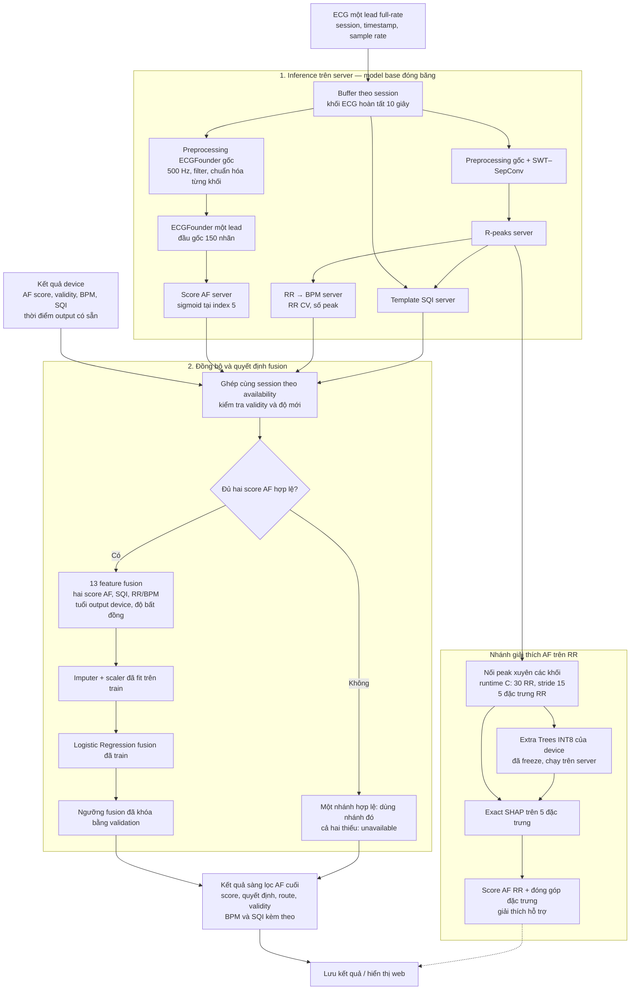

# Server: inference và fusion AF

Sơ đồ mô tả pipeline đã chạy bằng host replay. Đầu ECGFounder và trọng số các model base được giữ nguyên. LR fusion đã fit riêng trên train SHDB-AF; khi inference chỉ nạp artifact đã lưu.

## Các ranh giới cần giữ đúng

- LR fusion nhận **score AF device và score AF ECGFounder**, cùng các feature chất lượng/nhịp. Score của Extra Trees chạy lại trên RR server **chưa là input của LR hiện tại**.
- SHAP giải thích Extra Trees trên RR; không phải lời giải thích ECGFounder hoặc quyết định LR fusion.
- SQI hiện là feature của fusion; chưa hard-gate tín hiệu chất lượng thấp. Không có denoiser riêng.
- 150 output ECGFounder được giữ và lưu; fusion hiện chỉ lấy nhãn AF ở index 5. Các model của bảng so sánh 7 phương pháp là các cấu hình benchmark, không được nối đồng thời vào LR hiện tại.
- Trong replay đã chạy, snapshot tại cuối khối + 1.000 ms, chỉ dùng output có sẵn tại snapshot. Ngưỡng được chọn trên validation SHDB-AF; ngưỡng fusion đã lưu là 0,657671. Ngưỡng float 0,5 của benchmark AFDB thuộc giao thức so sánh riêng.
- Lớp nhận BLE live còn cần hoàn thiện metadata về validity/availability và waveform full-rate; sơ đồ không xác nhận toàn bộ đường live đã tích hợp xong.

## Tệp Python và artifact

| Thành phần | Tệp |
| --- | --- |
| Điều phối replay inference + fusion | [run_published_fusion.py](../experiment/src/experiments/af_detection/run_published_fusion.py) |
| ECGFounder đầu gốc | [server.py](../experiment/src/experiments/af_detection/fusion_sync/server.py), lớp `FrozenServer` |
| SWT–SepConv, BPM và template SQI | [server_rhythm.py](../experiment/src/experiments/af_detection/fusion_sync/server_rhythm.py) |
| RR → runtime C và Extra Trees INT8 | [server_rr_af.py](../experiment/src/experiments/af_detection/fusion_sync/server_rr_af.py) |
| Giải thích feature RR | [rr_af_explanation.py](../experiment/src/experiments/af_detection/rr_af_explanation.py), [exact_rr_shap.py](../experiment/src/experiments/af_detection/exact_rr_shap.py) |
| Feature, LR fusion và fallback | [learning.py](../experiment/src/experiments/af_detection/fusion_sync/learning.py) |
| Artifact LR fusion đã train | [fusion_lr.joblib](../experiment/report/benchmark_runs/af_fusion_published_swt_20261103/models/fusion_lr.joblib) |

Pipeline và kết quả fusion: [AF_DEVICE_SERVER_FUSION_PIPELINE.md](AF_DEVICE_SERVER_FUSION_PIPELINE.md).

## Điều kiện nhiễu MITDB / QTDB đã chạy

| Cohort | Điều kiện |
| --- | --- |
| MITDB stress test | 3 loại NSTDB: BW (trôi đường nền), MA (nhiễu cơ), EM (chuyển động điện cực); mỗi loại có 6 mức SNR: −6, 0, 6, 12, 18, 24 dB |
| Tổng cấu hình MITDB | 18 cấu hình cộng nhiễu + 1 tín hiệu gốc = 19 điều kiện |
| QTDB hiện tại | Tín hiệu gốc, không cộng nhiễu nhân tạo |

“Tín hiệu gốc” vẫn có thể chứa nhiễu tự nhiên. Lượt so sánh QRS 26 phương pháp dùng crop gốc của MITDB/QTDB. SWT–SepConv chưa được chạy trên toàn bộ ma trận nhiễu NSTDB trong báo cáo này.

Nguồn: [báo cáo QRS/RR/BPM](../experiment/report/qrs_rr_bpm/REPORT.md).
