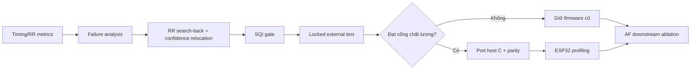

# Tổng kết tiến độ QRS, BPM, SQI và AF

Ngày cập nhật: **09/10/2026**

## 1. Tóm tắt điều hành

Tiến độ checklist hiện tại: **21/24 mục — 87,5%**.

| Giai đoạn | Hoàn thành | Trạng thái |
|---|---:|---|
| Trước benchmark | 6/6 | Hoàn thành |
| Sau benchmark | 4/6 | Còn metric timing/RR và failure analysis |
| Trước port firmware | 6/6 | Host Python–C parity hoàn thành; ESP32 parity là bước tích hợp tiếp theo |
| Trước kết luận luận án | 5/6 | Còn AF downstream ablation |
| **Tổng** | **21/24** | **Chưa đủ để kết luận cuối luận án** |

Kết quả hiện tại đã đủ để:

- mô tả kiến trúc và nguồn gốc pipeline QRS/BPM;
- so sánh detector cổ điển, adaptive và deep-learning ceiling;
- xác định Pareto accuracy–latency sơ bộ;
- đánh giá QTDB và NSTDB theo một protocol chung;
- chứng minh Adaptive PT v2 offline chưa thể port nguyên trạng;
- xây dựng prototype Adaptive PT causal, bounded-state bằng Python.

Kết quả hiện tại **chưa đủ** để:

- tuyên bố detector mới tốt hơn firmware;
- tuyên bố mức RAM thật trên ESP32 từ số liệu host;
- kết luận mức ảnh hưởng cuối cùng lên AF;
- nghiệm thu bản port C khi chưa có Python–C parity.

---

## 2. Checklist chi tiết

### 2.1 Trước benchmark — 6/6

- [x] **Chốt dataset, record, channel và annotation.**
  - MITDB, QTDB và NSTDB đã được sử dụng.
  - Protocol dùng channel 0; QTDB có 82 record chứa annotation `atr` phù hợp.
  - NSTDB dùng 12 record ECG đã trộn nhiễu `118eXX` và `119eXX`; không chấm ba noise source `bw`, `ma`, `em` như ECG.

- [x] **Chốt cửa sổ và tolerance.**
  - Cửa sổ benchmark chung: 60 giây.
  - Hai cửa sổ xác định/record trong benchmark ceiling hiện tại.
  - Tolerance: ±25, ±50, ±100 và ±150 ms.

- [x] **Chốt development/test split.**
  - 12 QTDB record được khai báo trước làm development cho Adaptive PT.
  - 70 QTDB record còn lại được dùng làm locked test cho bản portable.

- [x] **Chốt tham số detector.**
  - Adaptive PT v2 frozen: refractory 260 ms, integration 90 ms, threshold scale 0,38.
  - Adaptive portable frozen: integration 110 ms, raw relocation 100 ms, threshold fraction 0,35.

- [x] **Kiểm tra sampling rate/resampling.**
  - QTDB 250 Hz được giữ ở timeline gốc khi chấm điểm.
  - Firmware được resample đầu vào sang 360 Hz và peak được ánh xạ lại timeline gốc.
  - SWT–SepConv dùng preprocessing/resampling chính chủ.

- [x] **Kiểm tra beat-symbol whitelist.**
  - Benchmark dùng beat-symbol whitelist thống nhất trong scorer.
  - Matching peak là one-to-one.

**Minh chứng:**

- `experiments/evaluate_mitdb_external.py`
- `experiments/benchmark_qrs_ceiling.py`
- `experiments/tune_adaptive_pt_dev.py`
- `experiments/tune_adaptive_portable_dev.py`
- `outputs/adaptive_pt_v2_dev/frozen_config.json`
- `outputs/adaptive_portable_dev/frozen_config.json`

---

### 2.2 Sau benchmark — 4/6

- [x] **Báo Precision/Recall/F1 ở nhiều tolerance.**
  - Đã có kết quả tại ±25/50/100/150 ms.
  - Có raw CSV và manifest cho QTDB/NSTDB.

- [ ] **Báo đầy đủ Timing MAE và RR MAE.**
  - Hàm scoring đã hỗ trợ hai metric này.
  - Runner ceiling hiện chưa tổng hợp chúng vào bảng kết quả chung.
  - Cần bổ sung vào `per_window.csv`, `summary.csv` và báo cáo.

- [x] **Báo latency p50/p95.**
  - Runner đã đo sau warm-up và xuất median/p95.
  - Latency hiện tại là host CPU, không phải latency ESP32.

- [x] **Phân tầng theo record/SNR/noise type.**
  - NSTDB đã được phân tầng theo +24, +18, +12, +6, 0 và −6 dB.
  - Đã tách cửa sổ sạch và cửa sổ có nhiễu để tránh aggregate che mất failure.

- [ ] **Kiểm tra failure examples.**
  - Chưa có bộ hình/CSV các trường hợp FP, FN, localization lệch, T-wave và electrode motion điển hình.
  - Cần chọn record đại diện và vẽ ECG + annotation + peak của từng detector.

- [x] **Không gọi host RSS là ESP32 RAM.**
  - Manifest và báo cáo đã ghi cảnh báo.
  - RAM portable được ước lượng từ state/ring, chưa gọi là số đo phần cứng.

**Minh chứng:**

- `outputs/qtdb_qrs_ceiling/`
- `outputs/nstdb_qrs_ceiling/`
- `outputs/adaptive_portable_qtdb_locked/`
- `outputs/adaptive_portable_nstdb/`
- `docs/QRS_CEILING_PARETO_REPORT.md`
- `docs/ADAPTIVE_PT_V2_PIPELINE_VA_KHA_NANG_PORT_FIRMWARE.md`

---

### 2.3 Trước port firmware — 6/6

- [x] **Thuật toán causal và bounded-state.**
  - `AdaptivePTPortable` chỉ dùng mẫu hiện tại/quá khứ.
  - Không còn `filtfilt`, centered median hay xử lý toàn record.

- [x] **Có batch/stream parity.**
  - Batch wrapper sử dụng đúng state machine sample-by-sample.
  - Test batch và stream cho output giống nhau.

- [x] **Không phụ thuộc chunk size.**
  - Test chia tín hiệu thành 13 chunk vẫn tạo cùng danh sách peak.

- [x] **Có golden vectors Python–C.**
  - Host C reference đã được viết và compile thành DLL.
  - Sáu vectors gồm synthetic, QTDB và NSTDB đều pass.
  - Peak count, từng timestamp, event trace, envelope, SPKI và NPKI khớp; peak lệch lớn nhất 0 sample.
  - Đây là parity cấp host reference; float32/Xtensa/ESP32 parity vẫn thuộc bước tích hợp firmware tiếp theo.

- [x] **Ước lượng ring/state RAM.**
  - Ở 360 Hz, state portable ước tính khoảng 0,35–0,5 KB khi dùng `float32` và raw `int16_t`.
  - Cần đo stack/heap thật sau khi có code C.

- [x] **Cấu hình frozen.**
  - Tham số portable được chọn trên development records rồi khóa trước locked test.

**Minh chứng:**

- `src/ecg_benchmark/rpeaks.py`
- `tests/test_rpeaks.py`
- `outputs/adaptive_portable_dev/frozen_config.json`
- `outputs/adaptive_pt_python_c_parity/golden_vectors.json`
- `outputs/adaptive_pt_python_c_parity/parity_results.csv`
- `docs/GOLDEN_VECTOR_PARITY_ADAPTIVE_PT_PYTHON_C.md`

---

### 2.4 Trước kết luận luận án — 5/6

- [x] **Có accuracy ceiling.**
  - SWT + separable CNN + ASPP, checkpoint chính chủ.
  - QTDB: F1 0,9984 tại ±50 ms.
  - NSTDB aggregate: F1 0,9683 tại ±50 ms.

- [x] **Có classical baseline.**
  - Pan–Tompkins, GQRS, XQRS, Fast-QRS và các detector thư viện khác đã được đưa vào protocol.

- [x] **Có Pareto accuracy–latency–RAM.**
  - Accuracy và host latency đã có.
  - RAM firmware hiện mới là state estimate; Pareto cuối cần số đo ESP32 thật.

- [x] **Có external/cross-database evidence.**
  - MITDB, QTDB và NSTDB đã cho thấy domain/noise ảnh hưởng khác nhau.
  - QTDB locked test tách khỏi development của bản portable.

- [ ] **Có AF downstream ablation.**
  - Chưa chạy cùng AF classifier với annotation peaks, ceiling peaks, Adaptive PT, firmware và firmware + SQI.
  - Đây là mục quan trọng nhất còn thiếu.

- [x] **Có giới hạn nghiên cứu và kết quả âm.**
  - Adaptive PT v2 không vượt v1 trên MITDB external.
  - Adaptive portable chưa vượt firmware trên QTDB locked.
  - Các kết quả âm đã được giữ lại và báo cáo.

**Minh chứng:**

- `docs/BPM_COMMON_PROTOCOL_AND_ARCHITECTURE.md`
- `docs/QRS_CEILING_PARETO_REPORT.md`
- `docs/ADAPTIVE_PT_V2_EXTERNAL_REPORT.md`
- `docs/ADAPTIVE_PT_V2_PIPELINE_VA_KHA_NANG_PORT_FIRMWARE.md`

---

## 3. Kết quả kỹ thuật chính

### 3.1 QTDB tại ±50 ms

| Detector | Precision | Recall | F1 | BPM MAE | Host latency/60 s |
|---|---:|---:|---:|---:|---:|
| SWT–SepConv ceiling | 0,9978 | 0,9990 | **0,9984** | 0,134 | 110,12 ms |
| GQRS | 0,9628 | 0,9574 | 0,9601 | 0,181 | 96,45 ms |
| Adaptive PT v1 | 0,8994 | 0,8954 | 0,8974 | 0,179 | 5,88 ms |
| Adaptive PT v2 | 0,8994 | 0,8916 | 0,8955 | 0,204 | 5,95 ms |
| Firmware hiện tại | 0,8530 | 0,8600 | **0,8564** | 0,836 | **3,80 ms** |

Ở ±100 ms:

- Adaptive PT v1: F1 0,9971.
- Firmware hiện tại: F1 0,9823.
- SWT–SepConv: F1 0,9993.

Điều này cho thấy phần lớn khoảng cách strict F1 của detector nhẹ nằm ở localization.

### 3.2 NSTDB, cửa sổ có nhiễu tại ±50 ms

| Detector | −6 dB | 0 dB | 6 dB | 12 dB |
|---|---:|---:|---:|---:|
| SWT–SepConv | **0,6892** | **0,9635** | **0,9933** | **0,9966** |
| Adaptive PT v2 | 0,5215 | 0,8961 | 0,9797 | 0,9730 |
| Adaptive portable | 0,4649 | 0,7295 | **0,9864** | **0,9864** |
| Firmware hiện tại | 0,3253 | 0,6892 | 0,9216 | 0,9797 |

Vùng detector nhẹ bắt đầu suy giảm rõ là khoảng **0–6 dB**. Đây là vùng phù hợp để kích hoạt SQI/noise gate.

### 3.3 Adaptive portable trên QTDB locked

| Detector | F1 @50 ms | F1 @100 ms | BPM MAE |
|---|---:|---:|---:|
| Adaptive PT v1 offline | 0,8919 | 0,9969 | 0,178 |
| Adaptive PT v2 offline | 0,8896 | 0,9944 | 0,208 |
| Firmware hiện tại | **0,8446** | **0,9801** | **0,953** |
| Adaptive portable | 0,8139 | 0,9375 | 4,970 |

Quyết định: bản portable có kiến trúc phù hợp để tiếp tục nghiên cứu nhưng **chưa đạt cổng chất lượng để port/thay firmware**.

---

## 4. Bốn phần việc còn thiếu

### P1 — Bổ sung Timing MAE và RR MAE

Mục tiêu:

- thêm hai metric vào runner chung;
- báo micro/macro theo detector, dataset và tolerance;
- phân biệt lỗi detection với lỗi localization.

Tiêu chí hoàn thành:

- `summary.csv` có timing MAE và RR MAE;
- báo cáo QTDB/NSTDB được cập nhật;
- không dùng unmatched peaks để tính timing/RR MAE sai cách.

### P2 — Failure-case analysis

Tối thiểu cần các nhóm:

- QRS âm/hai pha;
- QRS rộng/PVC;
- T-wave lớn;
- baseline wander;
- muscle artifact;
- electrode motion/clipping;
- missed beat và double detection.

Mỗi hình nên có:

- ECG raw/filtered;
- annotation;
- firmware peak;
- Adaptive PT peak;
- ceiling peak;
- threshold/envelope hoặc SQI nếu có.

### P3 — Port C lên float32/ESP32

Host double Python–C parity đã hoàn thành. Phần còn lại:

1. chuyển host reference từ double sang float32/int16;
2. chạy lại cùng golden vectors;
3. yêu cầu peak lệch không quá 1 sample;
4. tích hợp Xtensa/ESP32;
5. replay và so ESP32 với host C;
6. đo stack, heap, CPU và event latency thật.

Không port prototype portable hiện tại vào production trước khi chất lượng Python vượt cổng đã đặt.

### P4 — AF downstream ablation

Chạy cùng một AF model và split với năm nguồn R-peak:

1. annotation/oracle;
2. SWT–SepConv ceiling;
3. Adaptive PT;
4. firmware hiện tại;
5. firmware + SQI gate.

Báo:

- AF precision/recall/F1;
- AUROC và AUPRC nếu phù hợp;
- degradation so với oracle;
- coverage sau gate;
- kết quả theo SQI/SNR;
- tương quan QRS FP/FN/RR error với lỗi AF.

---

## 5. Thứ tự ưu tiên đề xuất

Ưu tiên thực tế:

1. **Timing/RR metrics và failure examples** — biết chính xác cần sửa detection hay localization.
2. **RR search-back + confidence-aware relocation** — chi phí state nhỏ, có khả năng giảm FN/BPM error.
3. **SQI gate** — bảo vệ AF khi tín hiệu nằm trong vùng 0–6 dB.
4. **AF ablation** — xác nhận cải tiến QRS có giá trị downstream.
5. **Port C** — chỉ thực hiện khi Python causal đạt cổng chất lượng.

---

## 6. Cổng chất lượng đề xuất

Trước khi thay firmware hiện tại, detector mới cần đạt đồng thời:

- QTDB locked F1 @50 ms ≥ 0,8446;
- QTDB F1 @100 ms ≥ 0,9801;
- QTDB BPM MAE < 1 BPM;
- NSTDB 0 dB tốt hơn 0,6892;
- không giảm đáng kể ở SNR ≥6 dB;
- causal, bounded-state và chunk-independent;
- Python–C parity không quá 1 sample;
- RAM/stack nằm trong ngân sách ESP32;
- AF downstream không giảm so với firmware cũ, hoặc cải thiện có ý nghĩa.

---

## 7. Tài liệu và artefact chính

- `docs/CAM_NANG_QRS_BPM_SQI_AF_CHO_LUAN_AN.md`: cẩm nang kiến thức tổng hợp.
- `docs/ADAPTIVE_PT_V2_PIPELINE_VA_KHA_NANG_PORT_FIRMWARE.md`: kiến trúc và khả năng port.
- `docs/QRS_CEILING_PARETO_REPORT.md`: ceiling và Pareto QTDB/NSTDB.
- `docs/BPM_COMMON_PROTOCOL_AND_ARCHITECTURE.md`: protocol chung và kiến trúc.
- `src/ecg_benchmark/rpeaks.py`: implementation detector/scorer.
- `experiments/benchmark_qrs_ceiling.py`: runner benchmark chung.
- `experiments/tune_adaptive_portable_dev.py`: tuning development.
- `tests/test_rpeaks.py`: test matching, scoring và streaming.
- `external/ECG_peak_detection/`: SWT–SepConv chính chủ.

---

## 8. Kết luận tiến độ

Phần QRS/BPM hiện đã có baseline, ceiling, protocol chung, cross-database evidence và prototype causal. Khoảng trống lớn nhất không còn là “thiếu thêm một detector”, mà là:

1. định lượng chính xác timing/RR error;
2. hiểu failure theo morphology/noise;
3. chứng minh parity khi port;
4. chứng minh tác động thật lên AF.

Vì vậy con số **87,5%** thể hiện mức hoàn thành checklist kỹ thuật, không có nghĩa luận án đã hoàn thành 87,5%. Hai hạng mục có trọng số khoa học cao nhất còn lại là **AF downstream ablation** và **ESP32 runtime validation**.
